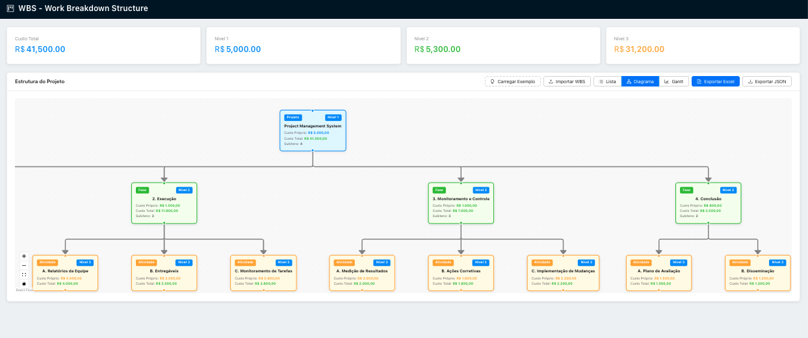
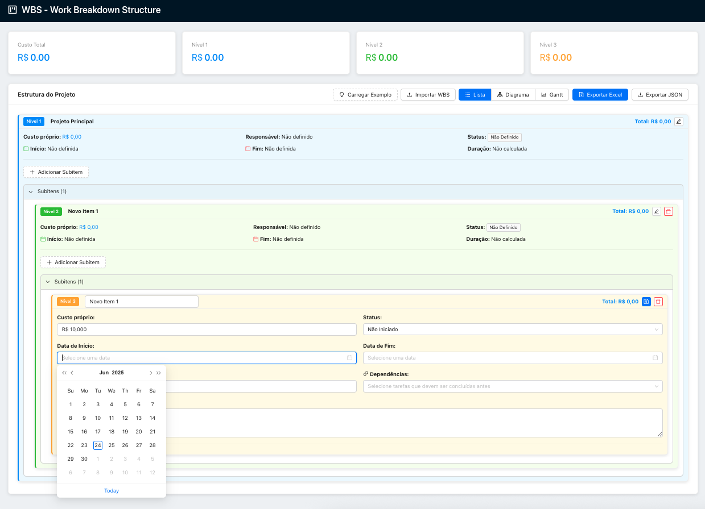
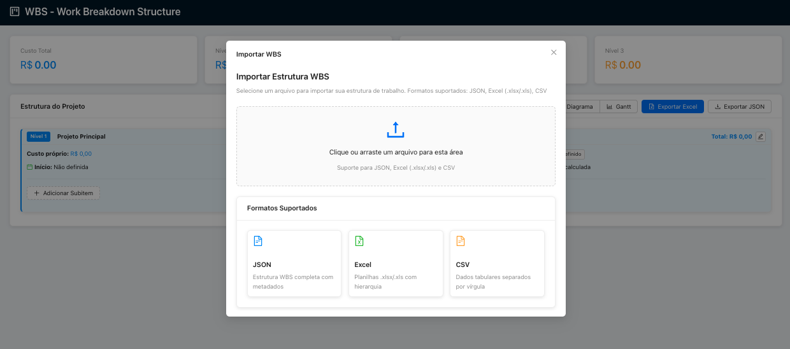
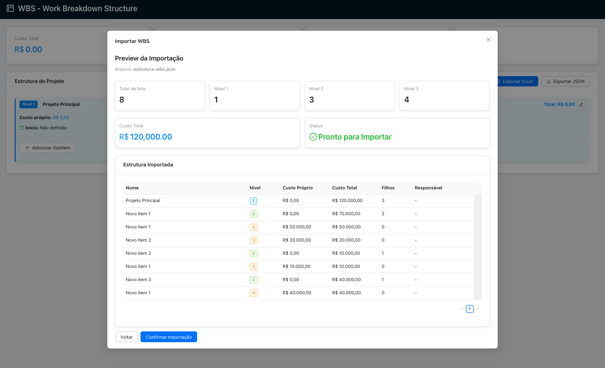
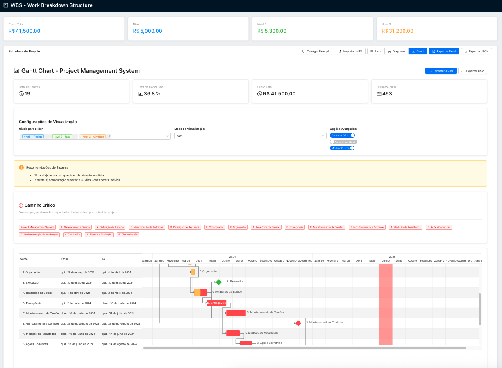

# WBS Dynamic Tree: Plataforma de Gestión de Costos Jerárquicos

[](https://reactjs.org/)
[](https://www.typescriptlang.org/)
[](https://ant.design/)
[](https://www.i18next.com/)
[]()
[]()
[](https://opensource.org/licenses/MIT)

WBS Dynamic Tree es una potente aplicación web diseñada para ayudar a los directores de proyectos y equipos a crear, gestionar y visualizar Estructuras de Desglose de Trabajo (WBS) jerárquicas con agregación automática de costos, capacidades avanzadas de exportación y herramientas integrales de análisis presupuestario.

---

## 🎯 Características Principales

### Funcionalidad Principal
- **📊 Estructura Jerárquica Dinámica**: Crea estructuras jerárquicas de 3 niveles ilimitadas con relaciones padre-hijo
- **💰 Agregación Automática de Costos**: Cálculo y consolidación en tiempo real de costos desde los nodos hijos hacia los padres
- **📤 Exportación Multiformato**: Exporta a Excel (.xlsx), JSON y CSV con formato profesional
- **📥 Importación Inteligente**: Importa estructuras existentes desde Excel, CSV o JSON con detección automática de columnas
- **📦 Agrupación de Fases**: Agrupa fases en nodos consolidados para una visualización simplificada manteniendo la agregación de costos

### Visualizaciones Avanzadas
- **📈 Diagrama de Gantt**: Vista cronológica de la estructura del proyecto con dependencias y ruta crítica
- **🌲 Vista de Árbol**: Display jerárquico interactivo con funcionalidad de expandir/colapsar y agrupación de fases
- **🌊 Árbol de Flujo**: Representación visual de flujo de la estructura del proyecto con soporte para fases agrupadas
- **📋 Vista Tabular**: Display tabular completo con indicadores jerárquicos y colapso de fases
- **💹 Asignación Presupuestaria**: Análisis presupuestario avanzado con distribución temporal y gráficos interactivos
- **🏆 Indicadores de Mérito**: Indicadores de rendimiento (KPI) con análisis de impacto por fase y monitoreo en tiempo real

### Análisis Presupuestario e Informes
- **📊 Distribución Temporal del Presupuesto**: Analiza la asignación presupuestaria en diferentes períodos de tiempo (mensual, trimestral, anual)
- **📈 Gráficos Interactivos**: Gráficos de arena y visualización de presupuesto acumulativo con alternancia de series
- **🎯 Análisis Multinivel**: Visualiza costos por nivel del proyecto o por fases individuales
- **📅 Filtrado por Rango de Fechas**: Centra el análisis en períodos específicos
- **💼 Panel Ejecutivo**: Métricas clave y análisis de variación presupuestaria

### Gestión del Rendimiento
- **🎯 KPI Personalizados**: Crea y gestiona indicadores de rendimiento con categorías personalizables
- **📊 Progreso en Tiempo Real**: Cálculo automático del progreso y clasificación de estados
- **🔗 Análisis de Impacto por Fase**: Configura cómo cada fase del proyecto afecta a los indicadores de rendimiento
- **📈 Monitoreo de Tendencias**: Sigue las tendencias de rendimiento con indicadores visuales de progreso
- **⚖️ Priorización Ponderada**: Prioriza indicadores con pesos configurables (1-10)
- **🌍 Objetivos Multidireccionales**: Soporte para objetivos de aumento, disminución o mantenimiento

### Interfaz Moderna
- **🎨 Interfaz Limpia**: Interfaz intuitiva construida con componentes de Ant Design
- **⚡ Actualizaciones en Tiempo Real**: Recálculo instantáneo de costos y totales mientras editas
- **🔍 Validación de Datos**: Validación integrada para garantizar la consistencia e integridad de los datos
- **📱 Diseño Responsivo**: Funciona sin problemas en escritorio, tablet y dispositivos móviles
- **📦 Agrupación Inteligente**: Controles de agrupación de fases para una navegación simplificada del proyecto
- **🔄 Estado Persistente**: Todas las preferencias y configuraciones del usuario se guardan automáticamente

### Internacionalización y Soporte de Monedas
- **🌍 Soporte Multilingüe**: Internacionalización completa con 4 idiomas soportados:
  - **🇧🇷 Portugués (Português)** - Localización completa para usuarios brasileños
  - **🇺🇸 Inglés** - Interfaz y contenido en inglés nativo
  - **🇪🇸 Español** - Traducción y localización completa al español
  - **🇨🇳 Chino (中文)** - Soporte integral del idioma chino
- **💱 Sistema de Monedas Independiente**: Selección de moneda independiente del idioma de la interfaz
- **💰 Soporte Multimonedas**: 6 monedas principales con localización adecuada:
  - **Real Brasileño (BRL)** - R$ con formato brasileño
  - **Dólar Estadounidense (USD)** - $ con formato americano
  - **Euro (EUR)** - € con formato europeo
  - **Yuan Chino (CNY)** - ¥ con formato chino
  - **Libra Esterlina (GBP)** - £ con formato británico
  - **Yen Japonés (JPY)** - ¥ con formato japonés
- **🔄 Configuración Persistente**: Preferencias de idioma y moneda guardadas y restauradas automáticamente
- **📊 Datos Localizados**: Números, fechas y monedas formateados según la configuración regional seleccionada

### Visualización TRL
- **🔬 Niveles TRL**: Visualiza los Niveles de Madurez Tecnológica (TRL) para diferentes fases del proyecto.
- **📊 Agrupación por Fases**: Agrupa fases por niveles TRL para simplificar el análisis y los informes.
- **🎨 Niveles con Código de Color**: Cada nivel TRL tiene un código de color para una fácil identificación.
- **📈 Estadísticas**: Visualiza estadísticas como fases totales, fases con TRL y TRL promedio.
- **🔍 Vista Detallada**: Expande las fases para ver información detallada y los responsables.
- **🌍 Internacionalización**: Soporte completamente localizado para múltiples idiomas.



## 🚀 Inicio Rápido

### Requisitos Previos

- Node.js 18+ 
- npm o yarn

### Instalación

```bash
# Clona el repositorio
git clone https://github.com/your-username/wbs-dynamic-tree.git

# Navega al directorio del proyecto
cd wbs-dynamic-tree

# Instala las dependencias
npm install

# Inicia el servidor de desarrollo
npm start
```

La aplicación se abrirá en `http://localhost:3000`

## 📚 Uso

### Creación de una Estructura de Proyecto

1. **Agrega Elementos de Nivel Raíz**: Comienza creando las fases o categorías principales de tu proyecto
2. **Construye la Jerarquía**: Agrega subelementos bajo cada categoría principal
3. **Agrega Detalles**: Incluye costos, descripciones, responsables y fechas
4. **Cálculo Automático**: Observa cómo los costos se consolidan automáticamente hacia los niveles padres



### Múltiples Opciones de Vista

#### 🌲 Vista de Árbol
- Display jerárquico interactivo
- Funcionalidad de expandir/colapsar
- Capacidades de edición en tiempo real
- Indicadores visuales de jerarquía
- **📦 Agrupación de Fases**: Agrupa fases seleccionadas en nodos consolidados "Otros" para una visualización simplificada
- **🔄 Agrupación Persistente**: La configuración de agrupación se guarda y restaura automáticamente entre sesiones
- **📊 Preservación de Costos**: Los costos agregados se mantienen cuando se agrupan las fases
- **🎯 Agrupación Bajo Demanda**: Selección manual de fases para agrupar a través de una interfaz modal intuitiva

#### 🌊 Vista de Árbol de Flujo  
- Representación visual de flujo
- Líneas de conexión entre nodos
- Ideal para visualización de procesos
- Diseño limpio y moderno
- **📦 Visualización de Fases Agrupadas**: Fases consolidadas mostradas como nodos especiales con tooltips
- **🎨 Diferenciación Visual**: Nodos agrupados resaltados con bordes discontinuos y esquema de color púrpura
- **📋 Detalles de Fase**: Los tooltips al pasar el mouse muestran todas las fases incluidas en los nodos agrupados
- **🔄 Sincronización en Tiempo Real**: Los cambios de agrupación se reflejan inmediatamente en la visualización de flujo

#### 📋 Vista Tabular
- Display tabular completo
- Sangría jerárquica con indicadores de nivel
- **Colapso de Fases**: Colapsa/expandir fases (nivel 2) para una mejor visión general
- Columnas ordenables con resolución de dependencias
- Capacidades de paginación y búsqueda
- Código de color por nivel jerárquico

#### 📈 Diagrama de Gantt
- Visualización cronológica con dependencias
- Seguimiento de duración y hitos
- Análisis de ruta crítica
- Resumen de asignación de recursos

#### 💹 Análisis de Asignación Presupuestaria
- **Análisis Temporal**: Visualiza la distribución del presupuesto a lo largo de los períodos de tiempo
- **Gráficos Interactivos**: 
  - Gráfico de arena que muestra la asignación presupuestaria a lo largo del tiempo
  - Progresión acumulativa del presupuesto
  - Alternancia de visibilidad de series para análisis enfocado
- **Agrupación Flexible**: Alterna entre análisis basado en niveles y basado en fases
- **Panel Ejecutivo**: Métricas clave incluyendo presupuesto total, gasto planificado y variación
- **Opciones de Período**: Análisis mensual, trimestral y anual
- **Filtrado por Rango de Fechas**: Enfócate en períodos específicos del proyecto

### Estructura de Ejemplo

```
Proyecto de Desarrollo de Software                 ($53,000)
├── 📋 Fase de Planificación                       ($8,000)
│   ├── Análisis de Requerimientos                ($5,000)
│   └── Documentación Técnica                     ($3,000)
├── 💻 Fase de Desarrollo                          ($35,000)
│   ├── Desarrollo Frontend                       ($15,000)
│   ├── Desarrollo Backend                        ($12,000)
│   └── Diseño de Base de Datos                   ($8,000)
└── 🧪 Fase de Pruebas                             ($10,000)
    ├── Pruebas Unitarias                         ($4,000)
    └── Pruebas de Integración                    ($6,000)

Costo Total del Proyecto: $53,000 (calculado automáticamente)
```

### Característica de Agrupación de Fases

**Simplifica Visualizaciones de Proyectos Complejos**

La característica de Agrupación de Fases te permite consolidar múltiples fases en un solo nodo "Otros", haciendo que las estructuras de proyectos complejos sean más fáciles de navegar y entender.

**Cómo Usar la Agrupación de Fases:**

1. **Accede a los Controles de Agrupación**: En la Vista de Árbol, haz clic en el botón "Configurar Agrupación" (icono 📦) junto al nombre de tu proyecto
2. **Selecciona Fases**: Usa la interfaz modal para seleccionar qué fases deseas agrupar
3. **Aplica la Agrupación**: Confirma tu selección para crear un nodo consolidado "Otros (X fases)"
4. **Retroalimentación Visual**: Las fases agrupadas se muestran con un estilo especial y tooltips
5. **Sincronización Multivista**: La agrupación se aplica automáticamente en todos los modos de visualización

**Beneficios de la Agrupación:**

- **📊 Navegación Simplificada**: Reduce el desorden visual en proyectos complejos
- **💰 Preservación de Costos**: Todos los cálculos y agregaciones de costos se mantienen
- **🔄 Configuración Persistente**: La configuración de agrupación se guarda automáticamente entre sesiones
- **🎯 Control Flexible**: Agrega o elimina fases de la agrupación en cualquier momento
- **📋 Información Detallada**: Los tooltips al pasar el mouse muestran todas las fases incluidas en los nodos agrupados

**Ejemplo con Agrupación:**

```
Proyecto de Desarrollo de Software                 ($53,000)
├── 📋 Fase de Planificación                       ($8,000)
│   ├── Análisis de Requerimientos                ($5,000)
│   └── Documentación Técnica                     ($3,000)
├── 📦 Otros (2 fases)                             ($45,000)
│   ├── 💻 Fase de Desarrollo                      ($35,000)
│   └── 🧪 Fase de Pruebas                        ($10,000)
```

**Indicadores Visuales:**

- **🟣 Borde Púrpura**: Los nodos agrupados tienen bordes discontinuos púrpuras
- **📁 Icono de Carpeta**: Icono de carpeta especial que indica contenido agrupado
- **💬 Detalles del Tooltip**: Pasa el mouse para ver todas las fases incluidas en el grupo
- **🔄 Expandir/Colapsar**: Alterna la visibilidad de las fases agrupadas dentro del nodo

### Importación de Datos

WBS Dynamic Tree soporta múltiples formatos de importación:

**Importación Excel/CSV**
- Detección automática de columnas para Nombre, Nivel, Costo, Descripción, Fechas
- Reconocimiento de estructura jerárquica a través de sangría o numeración
- Validación de datos y vista previa antes de confirmar la importación
- Soporte para dependencias y responsables





**Importación JSON**
- Importación completa de la estructura con todos los metadatos
- Preserva todos los campos personalizados y relaciones
- Perfecto para respaldar y restaurar proyectos

### Exportación de tu Trabajo

**Exportación a Excel**: Hojas de cálculo profesionales con:
- Formato y sangría jerárquica
- Tablas de desglose de costos y resúmenes
- Fórmulas para cálculos automáticos
- Estilos y colores personalizados
- Información de fechas y dependencias

**Exportación a JSON**: Exportación completa de datos para:
- Integración de sistemas y uso de API
- Respaldo y control de versiones
- Migración de datos entre entornos

### Configuración de Idioma y Moneda

**Cambiar el Idioma de la Interfaz**
- Accede al panel de Configuración (icono ⚙️ en la navegación superior)
- Selecciona tu idioma preferido en el menú desplegable:
  - Portugués (Português) - para usuarios brasileños
  - Inglés - para usuarios internacionales
  - Español - para usuarios hispanohablantes
  - Chino (中文) - para usuarios chinos
- La interfaz se actualizará inmediatamente a tu idioma seleccionado
- La preferencia de idioma se guarda y restaura automáticamente

**Configuración de Moneda**
- La configuración de moneda es independiente de la selección de idioma
- Configura tu moneda preferida en el panel de Configuración:
  - Real Brasileño (R$) - para proyectos brasileños
  - Dólar Estadounidense ($) - para proyectos americanos
  - Euro (€) - para proyectos europeos
  - Yuan Chino (¥) - para proyectos chinos
  - Libra Esterlina (£) - para proyectos del Reino Unido
  - Yen Japonés (¥) - para proyectos japoneses
- Todos los cálculos de costos, gráficos y exportaciones utilizarán tu moneda seleccionada
- La preferencia de moneda se guarda y restaura automáticamente

**Formateo Localizado**
- Los números y fechas se formatean según tu preferencia de idioma
- Los símbolos y formateo de monedas siguen estándares internacionales
- Los nombres de meses y formatos de fecha se adaptan a tu idioma seleccionado
- Los tooltips y etiquetas de los gráficos están completamente localizados

### Características de Análisis Presupuestario

**Distribución Temporal**
- Analiza cómo se distribuye el presupuesto a lo largo de la línea de tiempo del proyecto
- Asignación proporcional basada en la duración y fechas de las tareas
- Soporte para tareas y fases superpuestas

**Visualizaciones Interactivas**
- Haz clic en los elementos de la leyenda para mostrar/ocultar series específicas
- Alterna entre vistas agrupadas (por nivel) y separadas (por fase)
- Tooltips al pasar el mouse con información detallada de costos
- Capacidades de zoom y desplazamiento para análisis detallado

**Informes Ejecutivos**
- Análisis de variación presupuestaria
- Seguimiento de costos planificados vs reales
- Indicadores clave de rendimiento
- Exporta gráficos y datos para presentaciones

### Indicadores de Mérito (Indicadores de Rendimiento)

**Crear y Gestionar KPI**
- Define indicadores de rendimiento personalizados con múltiples categorías (Costo, Tiempo, Calidad, Alcance, Riesgo, Recursos, Personalizado)
- Establece valores base, actuales y objetivo con unidades personalizables
- Configura la dirección del indicador (aumentar, disminuir o mantener)
- Asigna pesos de prioridad (1-10) para enfocarse en indicadores críticos

**Análisis de Impacto por Fase**
- Configura cómo cada fase del proyecto afecta a los indicadores de rendimiento
- Establece porcentajes de impacto de -100% a +100% (negativo = obstaculiza, positivo = ayuda)
- Documenta descripciones de impacto para transparencia y comprensión
- Pondera la importancia de la fase dentro de cada indicador

**Monitoreo en Tiempo Real**
- Cálculo automático del progreso basado en valores actuales vs objetivo
- Clasificación de estado: En Ruta, En Riesgo, Fuera de Ruta, Completado
- Indicadores visuales de progreso con código de color por estado
- Métricas agregadas y análisis de tendencias

**Casos de Uso de Ejemplo**
```
Indicador de Eficiencia de Costos:
- Base: 75%, Actual: 82%, Objetivo: 90%
- Impactos por Fase: Planificación (+15%), Desarrollo (-5%), Pruebas (+10%)
- Estado: En Ruta (70% de progreso)

Indicador de Puntuación de Calidad:
- Base: 6.5/10, Actual: 7.2/10, Objetivo: 8.5/10
- Impactos por Fase: Planificación (+20%), Desarrollo (+30%), Pruebas (+50%)
- Estado: En Riesgo (40% de progreso)
```



## 🏗️ Arquitectura

### Stack Tecnológico

- **Frontend**: React 18 + TypeScript para una interfaz moderna y segura en tipos
- **Componentes de UI**: Ant Design para una interfaz profesional y accesible
- **Internacionalización**: i18next + react-i18next para soporte multilingüe
- **Procesamiento de Datos**: XLSX.js para manipulación de Excel sin backend
- **Visualización**: 
  - Gantt-Task-React para vistas de línea de tiempo del proyecto
  - Recharts para gráficos avanzados de análisis presupuestario
- **Manejo de Fechas**: date-fns para cálculos y formateo robusto de fechas
- **Gestión de Estado**: React Context y Hooks para flujo de datos eficiente

### Estructura del Proyecto

```
src/
├── components/                    # Componentes de UI reutilizables
│   ├── TreeView.tsx              # Componente principal de visualización de árbol
│   ├── TreeNode.tsx              # Componente de nodo individual
│   ├── TableView.tsx             # Vista tabular con jerarquía
│   ├── FlowTreeView.tsx          # Visualización de árbol basada en flujo
│   ├── GanttChart.tsx            # Visualización de línea de tiempo
│   ├── BudgetAllocationView.tsx  # Panel de análisis presupuestario
│   ├── MeritFigures.tsx          # Gestión de indicadores de rendimiento
│   └── ImportWBS.tsx             # Interfaz de importación de datos
├── services/                      # Lógica de negocio y utilidades
│   ├── exportService.ts          # Funcionalidad de exportación
│   ├── importService.ts          # Procesamiento de importación
│   └── ganttService.ts           # Procesamiento de datos del diagrama de Gantt
├── types/                         # Definiciones de tipos TypeScript
├── utils/                         # Funciones auxiliares
│   ├── costCalculator.ts         # Lógica de agregación de costos
│   └── dateCalculator.ts         # Cálculos de fechas y duración
└── data/                          # Datos de muestra y plantillas
```

### Algoritmos Clave

**Agregación de Costos**
- Cálculo de costos de abajo hacia arriba con actualizaciones en tiempo real
- Maneja jerarquías complejas con múltiples niveles
- Recálculo automático ante cambios de datos

**Sistema de Agrupación de Fases**
- Consolidación dinámica de fases con preservación de costos
- Configuración de agrupación persistente entre sesiones
- Sincronización multivista (Vistas de Árbol, Flujo y Tabular)
- Gestión de estado de agrupación en tiempo real

**Distribución Temporal del Presupuesto**
- Asignación proporcional de costos basada en la duración de las tareas
- Cálculo de intersección para períodos superpuestos
- Soporte para diferentes granularidades de tiempo

**Gestión de Datos Jerárquicos**
- Recorrido y manipulación eficiente de árboles
- Mantenimiento de relaciones padre-hijo
- Procesamiento y filtrado basado en niveles

## 📊 Rendimiento y Escalabilidad

- **Maneja 1000+ nodos** sin degradación del rendimiento
- **Cálculos en tiempo real** con algoritmos optimizados
- **Eficiencia en memoria** en el recorrido y actualización de árboles
- **Diseño responsivo** que funciona en escritorio, tablet y móvil
- **Optimización de gráficos** con controles de visibilidad de series para grandes conjuntos de datos
- **Carga diferida** para mejorar los tiempos de carga inicial
- **Agrupación eficiente** con consolidación instantánea de fases y recálculo de costos
- **Gestión de estado persistente** con operaciones optimizadas en localStorage

## 🎨 Características de UI/UX

### Jerarquía Visual
- Código de color por niveles (azul para proyectos, verde para fases, amarillo para actividades)
- Iconografía consistente en todas las vistas
- Sangría y señales visuales para comprensión jerárquica

### Elementos Interactivos
- Secciones colapsables en la vista tabular
- Funcionalidad de arrastrar y soltar (planificada)
- Menús contextuales para acciones rápidas
- Atajos de teclado para usuarios avanzados
- **📦 Controles de Agrupación de Fases**: Interfaz modal intuitiva para seleccionar fases a agrupar
- **🔄 Expandir/Colapsar Nodos Agrupados**: Alterna la visibilidad de las fases agrupadas
- **💬 Tooltips Interactivos**: Pasa el mouse para ver información detallada sobre fases agrupadas
- **🎯 Agrupación con un Clic**: Agrupación y desagrupación rápida de fases

### Accesibilidad
- Compatible con lectores de pantalla
- Soporte para navegación por teclado
- Compatibilidad con modo de alto contraste
- Cumplimiento WCAG 2.1

## 🤝 Contribuir

¡Bienvenidas las contribuciones a WBS Dynamic Tree! Ya sea que estés corrigiendo errores, agregando características o mejorando la documentación, tu ayuda es muy apreciada.

### Primeros Pasos

1. Haz un Fork del repositorio
2. Crea una rama de característica (`git checkout -b feature/nueva-caracteristica`)
3. Confirma tus cambios (`git commit -m 'Agregar nueva característica'`)
4. Empuja a la rama (`git push origin feature/nueva-caracteristica`)
5. Abre un Pull Request

### Pautas de Desarrollo

- Sigue las mejores prácticas de TypeScript
- Mantén la cobertura de pruebas por encima del 80%
- Usa componentes de Ant Design cuando sea posible
- Sigue el estilo y convenciones de código existentes
- Actualiza la documentación para nuevas características

## 📄 Licencia

Este proyecto está licenciado bajo la Licencia MIT - ver el archivo [LICENSE](LICENSE) para detalles.

## 🆘 Soporte

- **Documentación**: Consulta nuestro [Wiki](https://github.com/your-username/wbs-dynamic-tree/wiki) para guías detalladas
- **Problemas**: Reporta errores o solicita características a través de [GitHub Issues](https://github.com/your-username/wbs-dynamic-tree/issues)
- **Discusiones**: Únete a la comunidad en [GitHub Discussions](https://github.com/your-username/wbs-dynamic-tree/discussions)

---

**Construido con ❤️ usando React, TypeScript, Ant Design y Recharts**
